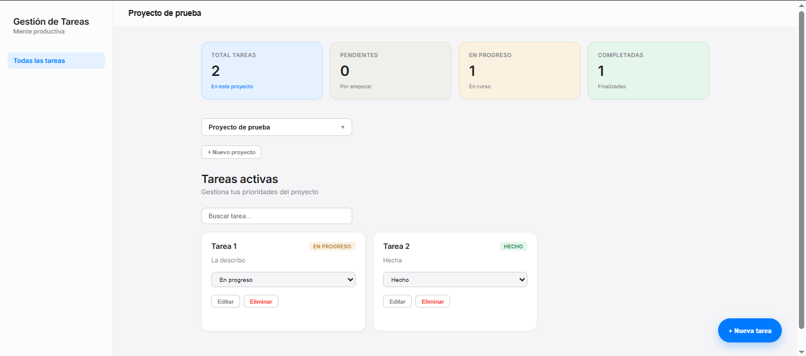
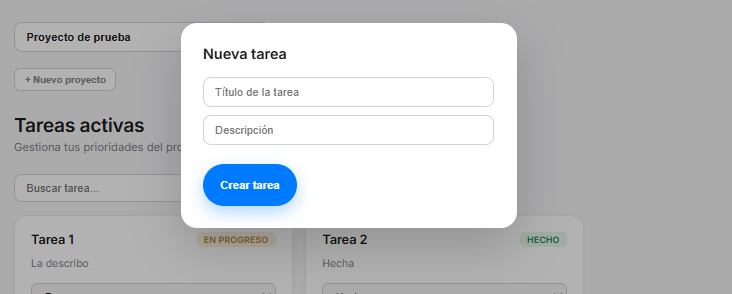
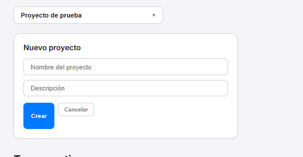

# 🗂️ Gestión de Tareas — Full Stack Application


🚀 **Proyecto Full Stack desarrollado con Spring Boot y React, aplicando Arquitectura Hexagonal, principios de DDD y pruebas automatizadas.**

Aplicación web para la gestión de proyectos y tareas desarrollada con **Java 21, Spring Boot 4.0.6, PostgreSQL y React**.

El proyecto implementa una separación entre dominio, aplicación e infraestructura en el backend, junto con una interfaz desarrollada en React que consume una API REST.

Su objetivo es demostrar buenas prácticas de desarrollo de software, diseño de arquitecturas desacopladas, persistencia de datos y construcción de aplicaciones web modernas.

Además, incorpora pruebas unitarias y de integración con JUnit 5, Mockito y Testcontainers para verificar el comportamiento de los servicios y la integridad de los datos.

---

## 📑 Índice

- [📸 Capturas](#-capturas)
- [📁 Estructura del repositorio](#-estructura-del-repositorio)
- [🏛️ Arquitectura](#️-arquitectura)
- [📊 Características técnicas](#-características-técnicas)
- [🏗️ Backend](#️-backend)
- [🧪 Testing y calidad](#-testing-y-calidad)
- [💻 Frontend](#-frontend)
- [🔗 Proyecto relacionado](#-proyecto-relacionado)
- [🚀 Retos y aprendizajes](#-retos-y-aprendizajes)
- [🔮 Mejoras futuras](#-mejoras-futuras)
- [👨‍💻 Autor](#-autor)

---

## 📸 Capturas

### Dashboard



### Creación de proyectos



### Creación y edición de tareas



---

## 📁 Estructura del repositorio

```text
gestion-tareas-fullstack/
├── backend/              # API REST en Spring Boot
├── frontend/             # Aplicación React con Vite
├── docs/                 # Capturas de pantalla
├── .gitignore
└── README.md
```

El repositorio separa el backend y el frontend en dos aplicaciones independientes que se comunican mediante HTTP y una API REST.

---

## 🏛️ Arquitectura

El backend sigue una **Arquitectura Hexagonal (Ports & Adapters)** junto con principios de **Domain-Driven Design (DDD)**.

```text
          React Frontend
                 |
                 v
         REST Controllers
                 |
                 v
        Puertos de Entrada
                 |
                 v
       Servicios de Aplicación
                 |
                 v
          Modelo de Dominio
                 |
                 v
         Puertos de Salida
                 |
                 v
         Adaptadores JPA
                 |
                 v
            PostgreSQL
```

### Separación de responsabilidades

**Dominio**

Contiene las entidades, reglas de negocio, excepciones y contratos que representan el núcleo de la aplicación.

**Aplicación**

Implementa los casos de uso y coordina las operaciones necesarias para ejecutar la lógica de negocio.

**Infraestructura**

Contiene los adaptadores que permiten conectar la aplicación con tecnologías externas, como controladores REST, Spring Data JPA y PostgreSQL.

### Ventajas de esta arquitectura

- Separación entre lógica de negocio y detalles técnicos.
- Menor acoplamiento con frameworks y bases de datos.
- Mayor facilidad para realizar pruebas unitarias.
- Código organizado y mantenible.
- Posibilidad de sustituir adaptadores sin modificar el núcleo de negocio.

---

## 📊 Características técnicas

- Arquitectura Hexagonal (Ports & Adapters).
- Principios de Domain-Driven Design (DDD).
- API REST con Spring Boot.
- Persistencia de datos con PostgreSQL.
- Spring Data JPA.
- Validación mediante Jakarta Validation.
- Manejo global de excepciones.
- Documentación de endpoints mediante Swagger/OpenAPI.
- Tests unitarios con JUnit 5 y Mockito.
- Tests de integración con Testcontainers.
- Gestión de transacciones mediante `@Transactional`.
- Configuración diferenciada para desarrollo y pruebas.
- Frontend React consumiendo la API REST.
- Diseño responsive.

---

# 🏗️ Backend

API REST desarrollada con **Java 21 y Spring Boot 4.0.6**, siguiendo una separación entre dominio, aplicación e infraestructura.

### Organización del código

```text
com.gestiontareas/
├── domain/
│   ├── model/
│   ├── port/
│   │   ├── in/
│   │   └── out/
│   └── exception/
├── application/
│   └── service/
└── infrastructure/
    ├── persistence/
    └── web/
```

### Tecnologías Backend

- Java 21.
- Spring Boot 4.0.6.
- Spring Data JPA.
- PostgreSQL.
- Maven.
- JUnit 5.
- Mockito.
- Testcontainers.
- Spring Boot Test.
- Swagger/OpenAPI.
- Jakarta Validation.

### Funcionalidades Backend

- Creación y consulta de usuarios.
- Creación, consulta por usuario y eliminación de proyectos.
- CRUD completo de tareas.
- Actualización del estado de las tareas mediante PATCH.
- Relaciones entre proyectos y tareas.
- Eliminación de tareas asociadas al eliminar un proyecto.
- Gestión transaccional de operaciones de eliminación.
- Validación de datos mediante Jakarta Validation.
- Gestión centralizada de excepciones mediante `@RestControllerAdvice`.
- Documentación automática de la API mediante Swagger.
- Tests unitarios y de integración.

### Ejecutar Backend

#### 1. Requisitos

Para ejecutar el backend se necesita:

- Java 21.
- PostgreSQL.
- Una base de datos disponible.
- Maven Wrapper incluido en el proyecto.

Docker es necesario para ejecutar las pruebas que utilizan Testcontainers.

#### 2. Crear la base de datos

Acceder a PostgreSQL y ejecutar:

```sql
CREATE DATABASE gestiontareas;
```

#### 3. Configurar PostgreSQL

La configuración de desarrollo se encuentra en:

```text
backend/src/main/resources/application-dev.properties
```

Su contenido es:

```properties
# Conexion a PostgreSQL de desarrollo
spring.datasource.url=jdbc:postgresql://localhost:5432/gestiontareas
spring.datasource.username=postgres
spring.datasource.password=${DB_PASSWORD}

# Configuracion JPA
spring.jpa.hibernate.ddl-auto=update
spring.jpa.show-sql=true
spring.jpa.properties.hibernate.format_sql=true
```

La contraseña se obtiene de la variable de entorno `DB_PASSWORD`, evitando almacenarla directamente en el repositorio.

En Windows PowerShell, establecer la contraseña para la sesión actual:

```powershell
$env:DB_PASSWORD="TU_CONTRASEÑA_POSTGRESQL"
```

Sustituir `TU_CONTRASEÑA_POSTGRESQL` por la contraseña correspondiente.

No subir contraseñas ni archivos con credenciales a GitHub.

#### 4. Iniciar la aplicación

Desde la raíz del repositorio:

```powershell
cd backend
```

En Windows:

```powershell
.\mvnw.cmd spring-boot:run
```

En Linux o macOS:

```bash
./mvnw spring-boot:run
```

El proyecto utiliza el perfil `dev` por defecto.

La API estará disponible en:

```text
http://localhost:8080
```

### Documentación Swagger

Swagger UI permite consultar los endpoints disponibles y realizar peticiones HTTP desde el navegador.

```text
http://localhost:8080/swagger-ui/index.html
```

La interfaz de Swagger se ha comprobado con la configuración actual del proyecto.

---

# 🧪 Testing y calidad

El backend incorpora pruebas automatizadas para verificar la lógica de negocio, la persistencia de datos y el comportamiento de las operaciones transaccionales.

### Tecnologías de testing

| Tecnología | Utilidad |
|---|---|
| JUnit 5 | Ejecución de pruebas automatizadas |
| Mockito | Simulación de dependencias en pruebas unitarias |
| Spring Boot Test | Pruebas con el contexto de Spring |
| Testcontainers | Ejecución de PostgreSQL en contenedores Docker |
| PostgreSQL 16 Alpine | Base de datos utilizada durante las pruebas de integración |

### Pruebas unitarias

Las pruebas unitarias permiten comprobar el comportamiento de los servicios de aplicación de forma aislada, utilizando Mockito para simular sus dependencias.

Entre ellas se incluyen pruebas del servicio de eliminación de proyectos.

### Pruebas de integración

Las pruebas de integración utilizan **Testcontainers** para levantar una instancia temporal de PostgreSQL.

Esto permite comprobar operaciones reales contra una base de datos PostgreSQL, sin depender de la base de datos local utilizada durante el desarrollo.

Se han incorporado pruebas para verificar:

- Integración de los servicios con la persistencia.
- Eliminación de proyectos y sus tareas asociadas.
- Comportamiento de las operaciones transaccionales.
- Conservación de datos cuando se produce un rollback.

### Transacciones y rollback

El servicio `EliminarProyectoService` utiliza `@Transactional` para garantizar que la eliminación de un proyecto y sus tareas se realice dentro de una misma transacción.

Si se produce un error durante la operación, la transacción puede revertirse para evitar que los datos queden en un estado inconsistente.

Las pruebas de integración comprueban este comportamiento utilizando PostgreSQL mediante Testcontainers.

### Configuración de pruebas

La configuración específica se encuentra en:

```text
backend/src/test/resources/application-test.properties
```

```properties
spring.jpa.hibernate.ddl-auto=create-drop
spring.jpa.show-sql=true
spring.devtools.restart.enabled=false
spring.jpa.open-in-view=false
```

El perfil `test` mantiene separada la configuración de pruebas respecto al entorno de desarrollo.

Las clases de integración utilizan anotaciones como:

- `@SpringBootTest`
- `@ActiveProfiles("test")`
- `@Testcontainers`
- `@ServiceConnection`
- `@DirtiesContext`

### Ejecutar las pruebas

Es necesario tener Docker en funcionamiento para las pruebas que utilizan Testcontainers.

Desde `backend/`, ejecutar en Windows:

```powershell
.\mvnw.cmd clean test
```

En Linux o macOS:

```bash
./mvnw clean test
```

### Resultado de las pruebas

En la última ejecución completa verificada se obtuvo:

```text
Tests run: 25
Failures: 0
Errors: 0

BUILD SUCCESS
```

Las pruebas incluyen verificaciones unitarias y de integración, así como una comprobación específica del rollback de transacciones.

---

# 💻 Frontend

Interfaz desarrollada con **React y Vite** que consume la API REST del backend y proporciona una experiencia de usuario para gestionar proyectos y tareas.

### Tecnologías Frontend

- React 19.
- Vite 8.
- JavaScript ES6+.
- Bootstrap 5.
- CSS3.
- React Hooks.
- API REST.

### Funcionalidades Frontend

- Dashboard con métricas de tareas.
- Gestión de proyectos.
- Creación de tareas mediante modal.
- Edición de tareas existentes.
- Eliminación de tareas.
- Cambio de estado desde la interfaz.
- Búsqueda de tareas en tiempo real.
- Diseño responsive.
- Sidebar de navegación persistente.

### Ejecutar Frontend

Desde la raíz del repositorio:

```bash
cd frontend
```

Instalar las dependencias:

```bash
npm install
```

Iniciar el servidor de desarrollo:

```bash
npm run dev
```

La aplicación estará disponible normalmente en:

```text
http://localhost:5173
```

El frontend requiere que el backend esté ejecutándose en:

```text
http://localhost:8080
```

y que CORS permita las peticiones desde el origen del frontend.

Para utilizar todas las funcionalidades es necesario tener el backend y el frontend ejecutándose simultáneamente.

---

## 🔗 Proyecto relacionado

Este proyecto amplía la API desarrollada previamente en:

**Gestión de tareas Hexagonal (Backend)**

https://github.com/AirooSs/Gestion-tareas-hexagonal

---

## 🚀 Retos y aprendizajes

Durante el desarrollo de este proyecto trabajé conceptos habituales en aplicaciones empresariales:

- Diseño e implementación de una Arquitectura Hexagonal.
- Aplicación de principios de Domain-Driven Design (DDD).
- Desarrollo de una API REST desacoplada de la lógica de negocio.
- Construcción de una SPA con React.
- Gestión de estado mediante hooks y props.
- Integración entre frontend y backend mediante HTTP y CORS.
- Persistencia de información con Spring Data JPA y PostgreSQL.
- Escritura de pruebas unitarias con JUnit y Mockito.
- Creación de pruebas de integración con Testcontainers.
- Gestión de transacciones y comprobación de rollback.
- Separación de configuraciones mediante perfiles de Spring.
- Gestión de variables de entorno para credenciales.
- Resolución de problemas relacionados con Maven, Spring Boot y Git.
- Organización del código orientada a la mantenibilidad.

Uno de los aprendizajes más importantes fue comprobar cómo las pruebas de integración permiten detectar problemas que no siempre aparecen en las pruebas unitarias, especialmente cuando intervienen transacciones y operaciones sobre una base de datos real.

---

## 🔮 Mejoras futuras

Posibles ampliaciones del proyecto:

- Autenticación y autorización mediante JWT.
- Gestión de roles y permisos.
- Dockerización completa de frontend y backend.
- Automatización de pruebas mediante CI/CD.
- Despliegue de la aplicación en un entorno cloud.
- Sistema de notificaciones.
- Filtros avanzados y clasificación de tareas.
- Ampliación de la cobertura de pruebas automatizadas.

Estas funcionalidades se plantean como posibles evoluciones y no forman parte de los requisitos necesarios para utilizar la versión actual.

---


## 👨‍💻 Autor

**Francisco José Soria Navarrete**

Desarrollador Full Stack Junior | Java | Spring Boot | React

- 🌐 **Portfolio:** https://fransoria-portfolio.vercel.app/
- 💻 **GitHub:** https://github.com/AirooSs
- 💼 **LinkedIn:** https://www.linkedin.com/in/fran-soria-nav/