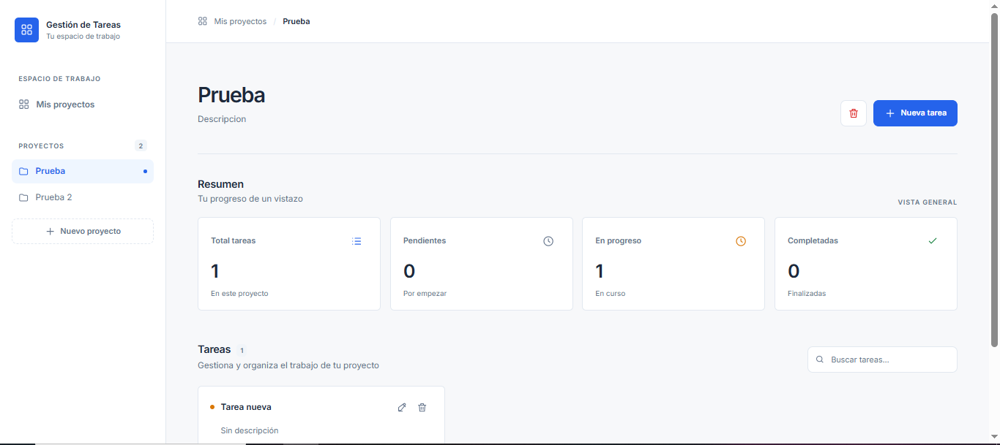
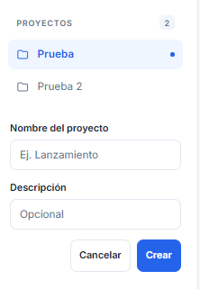
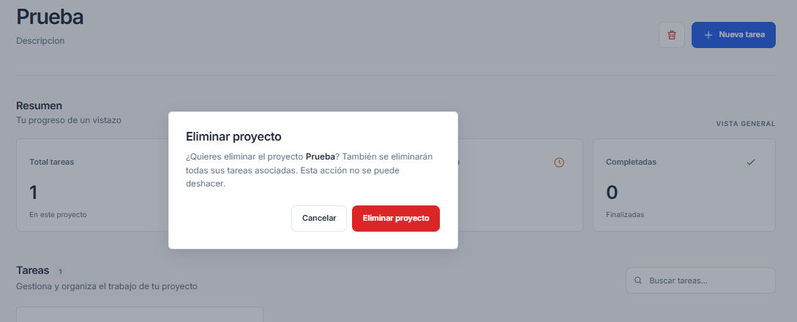

# Gestión de Tareas · Full Stack

Aplicación de gestión de proyectos y tareas con una interfaz React y una API REST en Java. El backend organiza el modelo, los casos de uso y los adaptadores siguiendo una arquitectura de puertos y adaptadores con elementos de DDD.

**Java 21 · Spring Boot 4.0.6 · PostgreSQL / Neon · React 19 · Vite 8**

## Qué permite hacer

- Crear y consultar usuarios mediante la API.
- Crear, listar y eliminar proyectos; gestionar las tareas de cada proyecto.
- Crear, consultar, editar, eliminar y cambiar el estado de tareas.
- Buscar tareas por título y consultar contadores del proyecto seleccionado en la interfaz.
- Consultar la documentación OpenAPI configurada en el backend.

La interfaz utiliza un identificador de usuario fijo y una URL de API local. La asignación de tareas aparece en el modelo, pero no existe un caso de uso ni endpoint de asignación en el código actual. No hay autenticación ni autorización implementadas.

## Capturas

**Panel del proyecto** · Navegación por proyectos, resumen y tareas.

Ver creación y eliminación de proyectos

**Crear un proyecto**

**Confirmar la eliminación**

## Inicio rápido

Se necesitan Java 21, PostgreSQL local o una base Neon preparada, Node.js y npm. Docker es necesario para las pruebas que usan Testcontainers.

Para ejecutar con PostgreSQL local:

1. Crear la base de datos `gestiontareas` y establecer `DB_PASSWORD` con la contraseña del usuario PostgreSQL `postgres`.
2. Desde `backend/`, ejecutar `./mvnw spring-boot:run` o, en Windows, `.\mvnw.cmd spring-boot:run`.
3. Desde `frontend/`, ejecutar `npm install` y después `npm run dev`.
4. Abrir `http://localhost:5173`. La API se configura en `http://localhost:8080`.

El perfil `dev` usa PostgreSQL local; el perfil `prod` utiliza `DATABASE_URL` de Neon con TLS y valida el esquema existente sin modificarlo. La configuración de Neon y los pasos de arranque están en [Puesta en marcha](docs/getting-started.md).

La validación del backend cubre 28 pruebas; consulta [Pruebas](docs/testing.md) para conocer el resultado y sus condiciones.

Consulta [Puesta en marcha](docs/getting-started.md) antes de utilizar el frontend: contiene información necesaria sobre el identificador de usuario fijo, configuración y pruebas.

## Documentación técnica

- [Arquitectura y DDD](docs/architecture.md)
- [Modelo de datos](docs/data-model.md)
- [Casos de uso](docs/use-cases.md)
- [API REST](docs/rest-api.md)
- [Transacciones y rollback](docs/transactions.md)
- [Pruebas](docs/testing.md)
- [Frontend](docs/frontend.md)
- [Puesta en marcha](docs/getting-started.md)
- [Catálogo de diagramas](docs/diagrams/README.md)

## Evolución posible

Entre las mejoras pendientes están la autenticación y autorización, la configuración externa del usuario y de la URL de API, el tratamiento consistente de errores, la integridad referencial y la ampliación de pruebas. Son propuestas, no funcionalidades existentes.

## Autor

**Francisco José Soria Navarrete** · [Portfolio](https://fransoria-portfolio.vercel.app/) · [GitHub](https://github.com/AirooSs) · [LinkedIn](https://www.linkedin.com/in/fran-soria-nav/)

Proyecto relacionado: [Gestión de tareas Hexagonal](https://github.com/AirooSs/Gestion-tareas-hexagonal).
