# Arquitectura y principios de dominio

[Inicio](../README.md) · [Datos](data-model.md) · [Casos de uso](use-cases.md)

La aplicación consta de una SPA React que llama por HTTP a una API Spring Boot protegida por Spring Security y tokens Bearer de sesiones anónimas. La API utiliza JPA y Spring Data para persistir en PostgreSQL: el perfil `dev` usa una instancia local y `prod` conecta con Neon mediante JDBC y TLS con verificación del certificado y del nombre del servidor.

## Capas y responsabilidades

| Área | Código | Responsabilidad |
|---|---|---|
| Dominio | `backend/src/main/java/com/gestiontareas/domain` | Modelos, identificadores, excepción y contratos de entrada y salida. |
| Aplicación | `application/service` | Implementaciones de los casos de uso que coordinan entidades y repositorios. |
| Infraestructura web | `infrastructure/web` | Controladores, DTO, validación HTTP, errores, CORS y configuración de beans. |
| Persistencia | `infrastructure/persistence` | Entidades JPA, mapeadores, adaptadores y repositorios Spring Data. |
| Configuración de Neon | `infrastructure/config` | Conversión de `DATABASE_URL` en un datasource JDBC para el perfil `prod`. |

El filtro de seguridad valida el hash del token y aplica límites en memoria. El servicio demo utiliza un puerto de persistencia para comprobar la sesión, las cuotas y la propiedad bajo transacción antes de invocar los casos de uso. Los controladores consumen los casos de uso. Los servicios usan interfaces de repositorio; los adaptadores JPA las implementan y delegan en Spring Data. `BeanConfiguration` conecta las implementaciones. Los mapeadores convierten objetos de dominio y entidades JPA.

Las flechas del diagrama de dependencias expresan dependencias de código, no el orden temporal de una petición. El servicio de eliminación de proyectos importa `@Transactional` de Spring, por lo que la capa de aplicación no es completamente independiente del framework.

El perfil `prod` emplea `ddl-auto=validate`, por lo que requiere un esquema compatible ya preparado y no crea ni modifica tablas al arrancar. `dev` conserva la configuración local y `ddl-auto=update`. Las credenciales solo se entregan al backend mediante variables de entorno.

## DDD en el código

`User`, `Project` y `Task` son modelos de dominio separados de las entidades JPA. `UserId`, `ProjectId` y `TaskId` encapsulan UUID; `Email` es un record que rechaza valores vacíos o sin `@`. `Task` inicializa su estado en `PENDIENTE` y ofrece operaciones para editar, cambiar estado y asignar usuario. Estos elementos aplican ideas de DDD y ayudan a expresar conceptos del dominio sin introducir JPA en el modelo.

El alcance es deliberadamente concreto: no hay que inferir agregados, contextos delimitados, eventos de dominio ni reglas de transición de estado a partir de estas clases. La validación HTTP y las restricciones de persistencia también participan en la protección de datos. Véanse [modelo de datos](data-model.md) y [transacciones](transactions.md).

Las fuentes editables y exportaciones están disponibles en el [catálogo de diagramas](diagrams/README.md).
