# Modelo de datos

[Inicio](../README.md) · [Arquitectura](architecture.md) · [API](rest-api.md)

Las clases `UserEntity`, `ProjectEntity` y `TaskEntity` definen las tablas siguientes. Los identificadores son UUID proporcionados por el dominio.

| Tabla | Columnas | Restricciones declaradas en JPA |
|---|---|---|
| `usuarios` | `id`, `name`, `email` | ID; nombre y email no nulos; email único. |
| `proyectos` | `id`, `name`, `description`, `owner_id` | ID; nombre y propietario no nulos. |
| `tareas` | `id`, `titulo`, `descripcion`, `status`, `project_id`, `assigned_to` | ID; título, estado y proyecto no nulos. |

`owner_id`, `project_id` y `assigned_to` representan referencias lógicas por UUID. Las entidades no declaran asociaciones JPA ni claves foráneas mediante anotaciones; tampoco hay cascada JPA declarada. El esquema de una base de datos concreta podría contener restricciones adicionales ajenas a estas clases. La eliminación de tareas de un proyecto se ejecuta explícitamente desde el servicio.

La creación de proyecto no consulta si existe el propietario y la creación de tarea no consulta si existe el proyecto. El campo `assigned_to` es opcional; aunque el modelo permite asignar una tarea, la API no expone esa operación.

Los estados de tarea son `PENDIENTE`, `EN_PROGRESO`, `HECHO` y `CANCELADO`. Se almacenan como texto. El constructor establece `PENDIENTE` y `cambiarEstado` asigna el valor recibido sin definir transiciones permitidas.

En desarrollo Hibernate usa `ddl-auto=update`; en el perfil de pruebas se usa `create-drop`. No se ha inspeccionado una base de datos desplegada.

Las fuentes editables y exportaciones están disponibles en el [catálogo de diagramas](diagrams/README.md).
