# Pruebas

[Inicio](../README.md) · [Puesta en marcha](getting-started.md)



## Pruebas presentes

- **Dominio:** `EmailTest` comprueba la creación y varios valores inválidos; `TaskTest` cubre estado inicial, cambio de estado y asignación.
- **Servicios:** JUnit y Mockito comprueban creación de usuario, proyecto y tarea; consulta y cambio de estado de tarea; y eliminación de proyecto, incluido el orden de eliminación.
- **Seguridad demo:** pruebas HTTP con PostgreSQL aislado verifican sesión, hash del token, aislamiento de recursos, caducidad, limpieza y cuotas; el limitador se comprueba por separado.
- **Despliegue:** `DeploymentWebConfigTest` comprueba el health check y las restricciones CORS.
- **Configuración de Neon:** `NeonDataSourceConfigTest` comprueba la conversión de la URI, TLS verificado y el tratamiento de entradas inválidas.
- **Integración:** Spring Boot Test y Testcontainers usan PostgreSQL `16-alpine` para comprobar carga del contexto, conexión, proxy transaccional y rollback al fallar la eliminación.

La prueba de rollback usa una base de datos real en contenedor y un espía que introduce el fallo. No se ha encontrado una suite de controladores HTTP ni una suite de frontend en el árbol de pruebas. No se dispone aquí de una medición de cobertura.

El perfil `test` ejecuta Flyway en PostgreSQL aislado y configura `ddl-auto=validate`, desactiva Open Session in View y el reinicio de DevTools. Las clases con Testcontainers requieren Docker operativo.

## Ejecución

Desde `backend/`:

```powershell
.\mvnw.cmd clean test
```

En Linux o macOS:

```bash
./mvnw clean test
```

En la validación del 18 de noviembre de 2026 se ejecutaron las pruebas con Java 21 y Docker: **38 pruebas superadas, 0 fallos, 0 errores y 0 omitidas**, incluidas las pruebas de seguridad de la demo y la comprobación de Flyway sobre un esquema existente sin historial. Las pruebas de integración usaron PostgreSQL `16-alpine` mediante Testcontainers. Maven finalizó con `BUILD SUCCESS`. Mockito mostró un aviso sobre la carga dinámica de su agente en futuras versiones del JDK.

También se verificaron con datos temporales el CRUD, la eliminación en cascada y la persistencia directa en Neon; se eliminaron los datos de prueba. En la misma validación, `npm run build` en `frontend/` terminó correctamente con Vite. Estos comandos generan archivos locales de compilación; un resultado anterior no garantiza el de ejecuciones futuras.

Las fuentes editables y exportaciones están disponibles en el [catálogo de diagramas](diagrams/README.md).

## Auditoría de dependencias

La revisión del 18 de noviembre de 2026 no detectó avisos OSV en el árbol Maven ni vulnerabilidades npm en las dependencias de producción. La auditoría completa de npm todavía muestra cinco alertas altas derivadas de `picomatch` 4.0.7, que solo se usa en herramientas de desarrollo y no aparece entre los módulos del bundle de producción. [GitHub retiró el aviso GHSA-fc5q-39xc-vjpf el 18 de noviembre de 2026](https://github.com/advisories/GHSA-fc5q-39xc-vjpf); npm aún lo muestra y no publica una versión corregida para ese aviso. Como precaución, no se deben procesar patrones glob no confiables ni exponer el servidor de desarrollo; conviene repetir la auditoría antes de desplegar.
