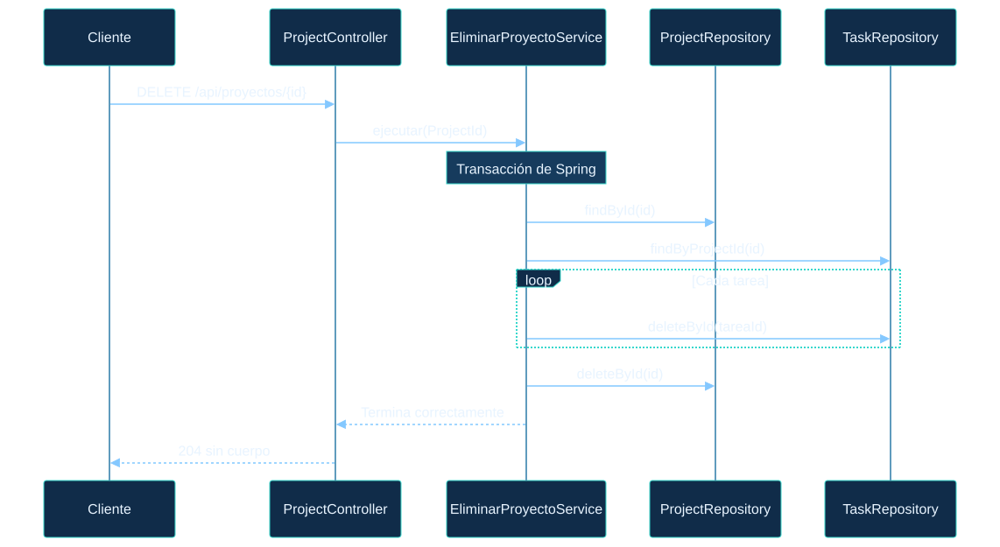

# Transacciones y rollback

[Inicio](../README.md) · [Pruebas](testing.md)

`EliminarProyectoService.ejecutar` tiene `@Transactional`. Al invocarlo a través del bean gestionado por Spring, comprueba el proyecto, busca sus tareas, elimina cada una y después elimina el proyecto. La operación se coordina desde aplicación y no por cascada JPA.

Una excepción no controlada de tipo `RuntimeException` durante el método provoca el rollback bajo las reglas predeterminadas de Spring. Las garantías dependen de que la llamada pase por el proxy transaccional y de que los accesos participen en la transacción. No se afirma que toda excepción comprobada o todo fallo externo se revierta automáticamente.

`EliminarProyectoTransaccionTest` comprueba que el caso de uso sea un proxy. `EliminarProyectoIntegrationTest` usa PostgreSQL con Testcontainers y un espía del adaptador de tareas: ejecuta la primera eliminación, provoca una excepción en la segunda y consulta mediante JDBC que permanezcan el proyecto y las dos tareas. Estas pruebas están escritas; su resultado requiere ejecutarlas en un entorno con Docker.

Las fuentes editables y exportaciones están disponibles en el [catálogo de diagramas](diagrams/README.md).
