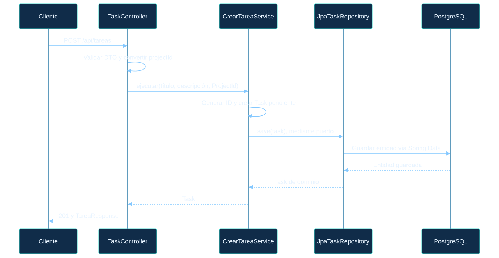
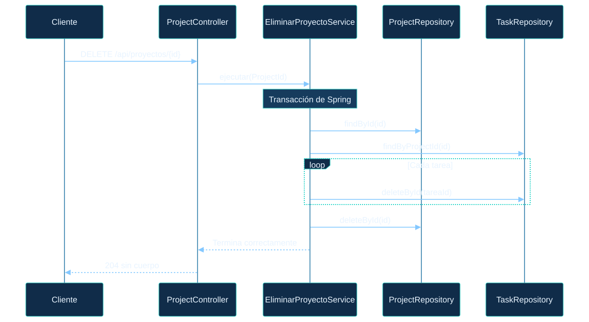

# Casos de uso

[Inicio](../README.md) · [API](rest-api.md)

Los puertos de entrada de `domain/port/in` son implementados por servicios de aplicación.

| Grupo | Caso de uso | Comportamiento |
|---|---|---|
| Usuarios | Crear | Genera ID y guarda nombre y `Email`. |
| Usuarios | Obtener | Busca por ID; si no existe, lanza `RecursoNoEncontradoException`. |
| Proyectos | Crear | Genera ID y guarda nombre, descripción y UUID del propietario. |
| Proyectos | Listar por usuario | Consulta proyectos por UUID de propietario. |
| Proyectos | Eliminar | Comprueba existencia y elimina tareas y proyecto en una transacción. |
| Tareas | Crear | Genera ID; el modelo inicia el estado como pendiente y se guarda. |
| Tareas | Obtener | Busca por ID o lanza la excepción de recurso no encontrado. |
| Tareas | Listar por proyecto | Consulta tareas por UUID de proyecto. |
| Tareas | Editar | Busca, cambia título y descripción y guarda. |
| Tareas | Eliminar | Comprueba existencia y elimina por ID. |
| Tareas | Actualizar estado | Busca, cambia estado y guarda; si falta, lanza `RuntimeException` genérica. |

En la API demo, el servicio de sesión comprueba previamente la propiedad de los proyectos y tareas. Los casos de uso de usuarios permanecen en el dominio, pero sus rutas HTTP están deshabilitadas. El modelo también tiene métodos de asignación y renombrado, pero no hay que confundirlos con operaciones expuestas por la API.

## Creación de una tarea

El controlador valida el DTO y el servicio demo comprueba que el proyecto pertenece a la sesión antes de convertir el UUID al identificador de dominio. El servicio crea `Task` y llama al puerto de salida; el adaptador convierte a entidad JPA, guarda y reconstruye el modelo. El controlador devuelve el DTO con código 201.

## Eliminación de un proyecto

La secuencia y sus límites se explican en [Transacciones y rollback](transactions.md).

Las fuentes editables y exportaciones están disponibles en el [catálogo de diagramas](diagrams/README.md).
